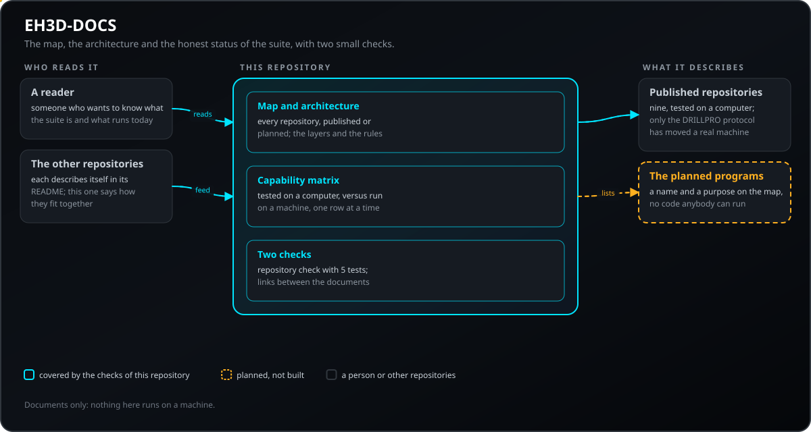
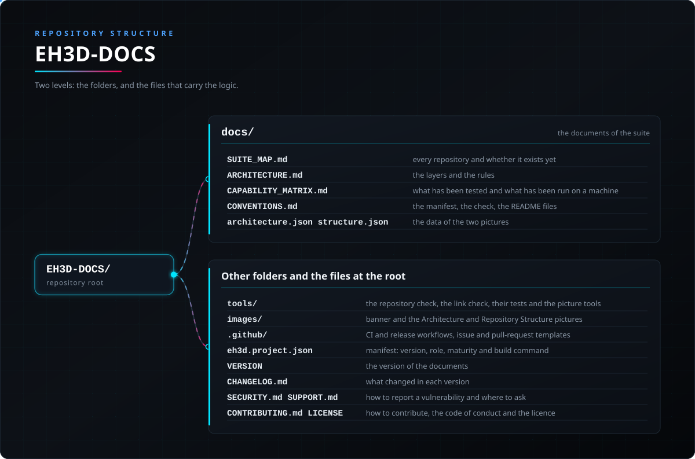

<p align="center">
  
</p>

# 📚 EH3D-DOCS

<p align="center"><a href="README.md">🇺🇸 English</a> | <a href="README_spa.md">🇪🇸 Español</a> | <a href="README_fra.md">🇫🇷 Français</a> | <a href="README_ita.md">🇮🇹 Italiano</a> | 🇩🇪 <b>Deutsch</b> | <a href="README_zho.md">🇨🇳 中文</a> | <a href="README_jpn.md">🇯🇵 日本語</a> | <a href="README_por.md">🇵🇹 Português</a></p>

### Die Karte, die Architektur und der ehrliche Stand der EH3D Fabrication Suite: wofür jedes Repository da ist, was getestet wurde und was noch nicht auf einer Maschine lief

<p align="center">
  
  
  
  
  
</p>

---

**Ehrlichkeitscheck - was heute tatsächlich läuft:** Dokumente und zwei kleine Prüfungen. Die Suite steht am Anfang: vierzehn Repositories sind veröffentlicht (EH3D-COMMON, EH3D-CORE-LIBS, EH3D-DRILLPRO, EH3D-ROUTEPRO, EH3D-BUNGARD-GUI, EH3D-MOTIONCNC, EH3D-SERVER, EH3D-STUDIO, EH3D-NODE-BUNGARD, EH3D-NODE-BUNGARD-HMI, EH3D-NODE-BUNGARD-AUX, EH3D-UPDATER, ELECTRO-HOBBY-3D-UPDATER und dieses), und jedes andere Programm der Suite ist ein Plan. Alles Veröffentlichte wurde auf einem Computer getestet; von der ganzen Suite hat nur das serielle Protokoll von EH3D-DRILLPRO eine echte Maschine bewegt (die Referenzfahrt und die Bewegungen jeder Achse an einer Bungard CCD MTC), und noch kein ganzer Auftrag lief auf einer Maschine. 5 Tests decken die Repository-Prüfung ab.

---

> **Stand von Sicherheit und IT-Sicherheit:** dieses Repository führt nichts auf einer Maschine aus und ist kein Sicherheitssystem (Safety). Ein Dokument hier ersetzt nie die Grenzen, Verriegelungen und den Not-Aus der Maschine und ihrer Steuerung.

## 📋 Auf einen Blick

| | |
|---|---|
| Version | `0.0.2` |
| Reifegrad | Gerüst |
| Tests | 5 |
| Technologie-Stack | Markdown, mit zwei Python-3.10+-Prüfungen |
| Auf echter Hardware | Nicht zutreffend: Dokumentation |

**Springe zu:** [Überblick](#-überblick) · [Architektur](#-architektur) · [Schnellstart](#-schnellstart) · [Tests](#-tests) · [Struktur](#-struktur-des-repositorys) · [Verwandte](#-verwandte-projekte)

## 🚦 Projektstatus

Jede Zeile ist ein Teil dieses Repositorys, und die Ampel sagt, wie weit er heute ist. Sie beruht auf dem, was das Repository zeigen kann (Tests, Builds, Läufe), nicht auf dem, was geplant ist.

🟢 Fertig und überprüft · 🟡 Funktioniert, mit bekannten Grenzen · 🟠 Teilweise fertig oder noch nicht überprüft · 🔴 Nicht gemacht oder funktioniert nicht

| Bereich | Stand | Was das hier bedeutet |
|---|---|---|
| Repository-Prüfungen | 🟡 | Die Repository-Prüfung, die Prüfung der Links zwischen den Dokumenten und die 5 Tests der Repository-Prüfung laufen in der CI und bestehen. |
| Tests | 🟠 | Nur die Repository-Prüfung hat Tests (5); die Dokumente und ihre Aussagen werden von Hand und mit den beiden Skripten gelesen und geprüft. |
| Karte und Fähigkeitsmatrix | 🟡 | Die Karte der Suite, die Architekturnotizen und die Fähigkeitsmatrix decken die elf veröffentlichten Repositories ab und führen jedes andere Programm als geplant; sie werden von Hand geschrieben und können hinter den Repositories zurückbleiben. |
| Echte Hardware | 🟡 | Nicht zutreffend: Dokumentation, nichts hier läuft auf Hardware. |
| Dokumentation | 🟡 | README in acht Sprachen, bei jeder Änderung gegen Manifest und Änderungsprotokoll geprüft. |

## 🎯 Überblick

* **Die Karte der Suite:** jedes Repository, wofür es da ist und ob es veröffentlicht oder nur geplant ist.
* **Die Architektur:** die zwei gemeinsamen Bibliotheken, die Programme, die davon abhängen sollen und nie voneinander, der Knoten und der Server, die die Maschine erreichen, und die Regeln jedes Repositorys.
* **Die Fähigkeitsmatrix:** was auf einem Computer getestet ist und was auf einer Maschine lief (nur das Protokoll von EH3D-DRILLPRO, an einer Maschine), damit niemand raten muss.
* **Die Konventionen:** das Manifest, das jedes Repository trägt, die Repository-Prüfung und die README-Dateien in acht Sprachen.
* **Zwei Prüfungen:** die Repository-Prüfung und eine Prüfung der Links zwischen den Dokumenten, beide in der CI.

## 🧩 Rolle in EH3D

EH3D-DOCS ist der Ort, an dem die Suite als Ganzes beschrieben wird. Jedes Repository beschreibt sich in seinem eigenen README; dieses sagt, wie sie zusammenpassen, welche es gibt und was wirklich gelaufen ist.

## 🏛️ Architektur

<p align="center">
  
</p>

Wie die Teile dieses Repositorys zusammenpassen: wer es nutzt, was es enthält und wovon es abhängt. Das Bild wird aus `docs/architecture.json` gezeichnet und gegen den Code geprüft.

## 🔒 Sicherheit und Schutz

Dieses Repository hat kein Programm, das Eingaben von außen annimmt; es schützt die Richtigkeit und die Sauberkeit dessen, was es veröffentlicht.

| Bedrohung | Abwehr |
|---|---|
| Die Behauptung, die Suite könne mehr, als sie kann | Die Fähigkeitsmatrix trennt „auf einem Computer getestet“ von „auf einer Maschine gelaufen“, und ein Repository gilt als geplant, bis es Code gibt, den jeder ausführen kann |
| Ein privater Verweis, eine Person oder ein Werkzeug, das nicht öffentlich sein darf | `tools/ci_validate.py` schlägt bei den Wörtern fehl, die nie in einer öffentlichen Datei stehen dürfen, in jeder Textdatei |
| Ein kaputter Link zwischen den Dokumenten | `tools/check_links.py` schlägt fehl, wenn ein relativer Link einer Markdown-Datei auf eine nicht vorhandene Datei zeigt |
| Eine README-Sprache driftet von den anderen ab | Die Prüfung vergleicht die Überschriftenstruktur, die Ampeln des Projektstatus und die Version in den acht Dateien |
| Dateien, die nicht versioniert werden dürfen (Builds, Schlüssel, Protokolle, große Dateien) | Die Repository-Prüfung weist versionierte Build-Ordner, private Ordner, Schlüssel- und Protokolldateien und Dateien über 1,5 MB ab |

## 🔌 Schnittstellen

| Schnittstelle | Was es ist | Wo |
|---|---|---|
| Die Dokumente | Markdown: die Karte, die Architektur, die Fähigkeitsmatrix und die Konventionen | [docs/](docs/SUITE_MAP.md) |
| Die Repository-Prüfung | `python -I tools/ci_validate.py` gibt `CI_VALIDATION=PASS` aus oder listet, was fehlschlägt | `tools/ci_validate.py` |
| Die Link-Prüfung | `python -I tools/check_links.py` gibt `LINKS=PASS` aus oder listet die kaputten Links | `tools/check_links.py` |
| Die Tests der Prüfung | `python -I -m unittest discover -s tools -p "test_*.py"` | `tools/test_ci_validate.py` |

## ⚙️ Konfiguration

Es gibt nichts zu konfigurieren: Die beiden Prüfungen brauchen Python 3.10 oder neuer und keine Installation und lesen die Dateien des Repositorys, in dem sie liegen. Die Regeln, die sie durchsetzen, stehen im Code von `tools/ci_validate.py`:

| Regel | Grenze | Wo |
|---|---|---|
| Größe einer versionierten Datei | höchstens 1.500.000 Bytes | `MAX_TRACKED_BYTES` |
| Sprachen des README | acht Dateien, mit derselben Überschriftenstruktur und denselben Ampeln | `LANGUAGES` |
| Manifestfelder | die 14 Felder von `REQUIRED`; die Version des Manifests entspricht der in `VERSION` (`native_version`) und im neuesten Eintrag des Änderungsprotokolls | `REQUIRED` |

## 🚀 Schnellstart

Du brauchst Python 3.10 oder neuer; es gibt nichts zu installieren.

```bash
python -I tools/ci_validate.py
python -I tools/check_links.py
python -I -m unittest discover -s tools -p "test_*.py"
```

Zum Lesen der Dokumente beginne mit [der Karte der Suite](docs/SUITE_MAP.md).

## 🧪 Tests

Die Repository-Prüfung hat 5 Tests (`python -I -m unittest discover -s tools -p "test_*.py"`), und sie bestehen. Die CI führt die Repository-Prüfung (`tools/ci_validate.py`), die Prüfung der Links zwischen den Dokumenten (`tools/check_links.py`) und diese Tests aus. Die Dokumente selbst haben darüber hinaus keinen Test: Was sie behaupten, bleibt ehrlich, indem man die Repositories liest, die sie beschreiben.

## 🏗️ Build und Veröffentlichung

Die Version steht in der Datei `VERSION` und in `eh3d.project.json`, und jede Version hat ihren Eintrag in [CHANGELOG.md](CHANGELOG.md). Es gibt nichts zu bauen; Releases werden auf GitHub veröffentlicht.

## 📂 Struktur des Repositorys

<p align="center">
  
</p>

<details>
<summary>Textversion des Baums</summary>

```text
EH3D-DOCS/
├── docs/
│   ├── SUITE_MAP.md                             jedes Repository und ob es schon existiert
│   ├── ARCHITECTURE.md                          die Schichten und die Regeln
│   ├── CAPABILITY_MATRIX.md                     was getestet wurde und was auf einer Maschine lief
│   ├── CONVENTIONS.md                           das Manifest, die Prüfung, die README-Dateien
│   └── architecture.json structure.json         die Daten der beiden Bilder
├── tools/                                       die Repository-Prüfung, die Link-Prüfung, ihre Tests und die Bildwerkzeuge
├── images/                                      Banner und die Bilder von Architektur und Repository-Struktur
├── .github/                                     CI- und Release-Workflows, Vorlagen für Issues und Pull Requests
├── eh3d.project.json                            Manifest: Version, Rolle, Reifegrad und Build-Befehl
├── VERSION                                      die Version der Dokumente
├── CHANGELOG.md                                 was sich in jeder Version geändert hat
├── SECURITY.md SUPPORT.md                       Schwachstellen melden und Fragen stellen
└── CONTRIBUTING.md CODE_OF_CONDUCT.md LICENSE   Mitwirken, Verhaltenskodex und Lizenz
```

</details>

## 🗺️ Roadmap und bekannte Grenzen

**Bekannte Grenzen heute**

* Die Karte, die Architekturnotizen und die Fähigkeitsmatrix werden von Hand geschrieben; nichts prüft sie gegen die Manifeste der Repositories, sie können also zurückbleiben.
* Nur die veröffentlichten Repositories sind ausführlich beschrieben; jedes andere Programm ist eine als geplant markierte Zeile der Karte.
* Die Dokumente haben keinen eigenen Test außer der Repository-Prüfung und der Link-Prüfung.

**Als Nächstes**

* Die Karte und die Fähigkeitsmatrix mit jedem Repository im Gleichschritt halten, wenn es veröffentlicht wird oder sich ändert.
* Die Karte gegen die Manifeste der Repositories prüfen, damit ein neues Repository darin nicht fehlen kann.

## 🌍 Sprachen

README und Texte gibt es auf Englisch, Spanisch, Französisch, Italienisch, Deutsch, Chinesisch, Japanisch und europäischem Portugiesisch.

## 🔗 Verwandte Projekte

* [EH3D-COMMON](https://github.com/JuanenRac/EH3D-COMMON): der Projektcontainer, die Maschinentypen und die Firmware-Basis der Knoten
* [EH3D-CORE-LIBS](https://github.com/JuanenRac/EH3D-CORE-LIBS): die Leser für Gerber, Excellon und G-Code
* [EH3D-DRILLPRO](https://github.com/JuanenRac/EH3D-DRILLPRO) und [EH3D-ROUTEPRO](https://github.com/JuanenRac/EH3D-ROUTEPRO): die Bohr- und Fräsprogramme
* [EH3D-BUNGARD-GUI](https://github.com/JuanenRac/EH3D-BUNGARD-GUI) und [EH3D-MOTIONCNC](https://github.com/JuanenRac/EH3D-MOTIONCNC): die moderne Oberfläche der Bungard-Maschinen und das Maschinensteuerprogramm
* [EH3D-SERVER](https://github.com/JuanenRac/EH3D-SERVER) und [EH3D-NODE-BUNGARD](https://github.com/JuanenRac/EH3D-NODE-BUNGARD): das Zentrum der Programme und der Knoten, der die Maschine erreicht
* [EH3D-STUDIO](https://github.com/JuanenRac/EH3D-STUDIO), [EH3D-NODE-BUNGARD-HMI](https://github.com/JuanenRac/EH3D-NODE-BUNGARD-HMI) und [EH3D-NODE-BUNGARD-AUX](https://github.com/JuanenRac/EH3D-NODE-BUNGARD-AUX): das Konfigurationspanel des Servers (mit seinen Aktualisierungen von GitHub), der Touchscreen der Maschine und der Knoten am Bohrkopf (Kamera über RTSP und ONVIF, Laser, der den Tisch misst, Drehzahl und Temperatur der Spindel)
* [EH3D-UPDATER](https://github.com/JuanenRac/EH3D-UPDATER) und [ELECTRO-HOBBY-3D-UPDATER](https://github.com/JuanenRac/ELECTRO-HOBBY-3D-UPDATER): installieren und aktualisieren die Repositories

## 📚 Dokumentation

* [Die Karte der Suite](docs/SUITE_MAP.md), [die Architektur](docs/ARCHITECTURE.md), [die Fähigkeitsmatrix](docs/CAPABILITY_MATRIX.md) und [die Konventionen](docs/CONVENTIONS.md).
* [Änderungsprotokoll](CHANGELOG.md)

## 🤝 Mitwirken und Community

* Führe vor einem Pull Request `python -I tools/ci_validate.py`, `python -I tools/check_links.py` und die Tests der Prüfung aus: alles muss bestehen. Siehe [CONTRIBUTING.md](CONTRIBUTING.md) und den [Verhaltenskodex](CODE_OF_CONDUCT.md).
* Das README gibt es in acht Sprachen: Eine Textänderung wird in allen acht Dateien gemacht, und die beiden Bilder werden aus `docs/architecture.json` und `docs/structure.json` mit `tools/make_architecture.py` und `tools/make_structure.py` gezeichnet.
* Beschreibe nicht als auf einer Maschine funktionierend, was nur auf einem Computer erprobt wurde: Die Fähigkeitsmatrix sagt, was was ist.
* Melde eine Schwachstelle privat: [SECURITY.md](SECURITY.md). Fragen, Ideen und Meldungen: electrohobby3d@gmail.com ([SUPPORT.md](SUPPORT.md)).

## 👤 AUTOR

**JuanenRac (Electro Hobby 3D)** · electrohobby3d@gmail.com

## 📜 LIZENZ

Software: GPL-3.0-or-later. Siehe [LICENSE](LICENSE). Die Hardware-Entwürfe der Suite verwenden die CERN OHL-S.
