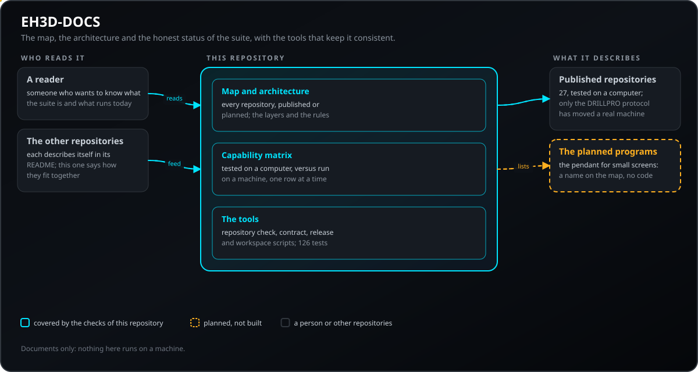
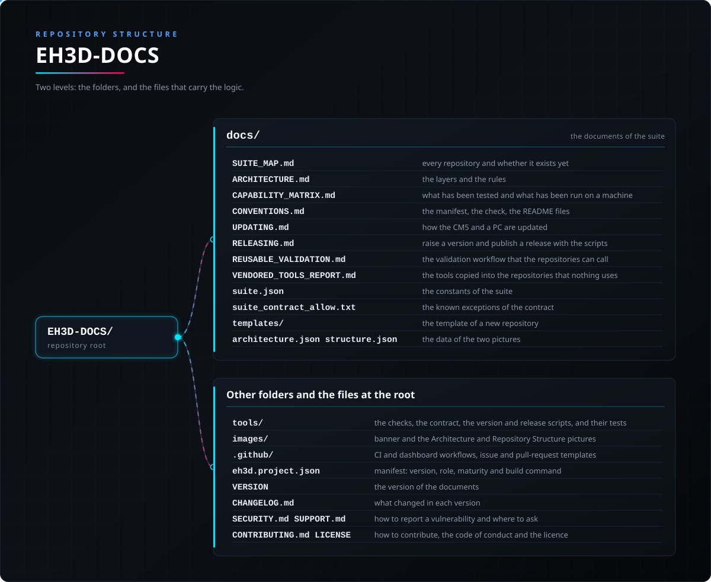

<p align="center">
  
</p>

# 📚 EH3D-DOCS

<p align="center"><a href="README.md">🇺🇸 English</a> | <a href="README_spa.md">🇪🇸 Español</a> | <a href="README_fra.md">🇫🇷 Français</a> | 🇮🇹 <b>Italiano</b> | <a href="README_deu.md">🇩🇪 Deutsch</a> | <a href="README_zho.md">🇨🇳 中文</a> | <a href="README_jpn.md">🇯🇵 日本語</a> | <a href="README_por.md">🇵🇹 Português</a></p>

### La mappa, l'architettura e lo stato onesto della EH3D Fabrication Suite: a cosa serve ogni repository, cosa è stato provato e cosa non è ancora stato eseguito su una macchina

<p align="center">
  
  
  
  
  
</p>

---

**Verifica di onestà - cosa funziona oggi:** documenti e gli strumenti della suite, che girano su un computer e da nessun'altra parte (il controllo del repository e i disegnatori delle immagini che ogni repository porta, il contratto tra i repository, gli script che alzano una versione e preparano un rilascio, lo script che prepara uno spazio di lavoro e quello che crea un nuovo repository). La suite è ai primi passi: sono pubblicati ventinove repository (le librerie, i programmi Bungard, il server e Studio, i nodi e gli schermi tattili, le app per telefono, i programmi CAM e di utilità, gli aggiornatori e questo), uno è stato avviato con codice e test e senza versione pubblicata (il laboratorio di prova del progetto di progettazione elettronica) e dieci sono solo previsti (il comando per piccoli schermi tattili e nove repository del progetto di progettazione elettronica e dei suoi ponti). Tutto ciò che è pubblicato è stato provato su un computer e le interfacce parlano 37 lingue; di tutta la suite solo il protocollo seriale di EH3D-DRILLPRO ha mosso una macchina reale (il riferimento e i movimenti di ogni asse su una Bungard CCD MTC), e nessun lavoro completo è ancora stato eseguito su una macchina. 14 test coprono il controllo del repository.

---

> **Stato di sicurezza funzionale e informatica:** questo repository non esegue nulla su una macchina e non è un sistema di sicurezza funzionale. Un documento di qui non sostituisce mai i limiti, gli interblocchi e l'arresto di emergenza della macchina e del suo controllore.

## 📋 In breve

| | |
|---|---|
| Versione | `0.0.8` |
| Maturità | Funzionale |
| Test | 191 |
| Stack tecnologico | Markdown, con strumenti in Python 3.10+ |
| Su hardware reale | Non applicabile: documentazione |

**Vai a:** [Panoramica](#-panoramica) · [Architettura](#-architettura) · [Avvio rapido](#-avvio-rapido) · [Test](#-test) · [Struttura](#-struttura-del-repository) · [Correlati](#-progetti-correlati)

## 🚦 Stato del progetto

Ogni riga è una parte di questo repository e il semaforo dice a che punto è oggi. È scritta in base a ciò che il repository può mostrare (test, compilazioni, esecuzioni), non a ciò che è previsto.

🟢 Fatto e verificato · 🟡 Funziona, con limiti noti · 🟠 Fatto a metà o non ancora verificato · 🔴 Non fatto o non funzionante

| Area | Stato | Cosa significa qui |
|---|---|---|
| Controlli del repository | 🟡 | Il controllo del repository, quello dei link tra i documenti e i test degli strumenti girano nella CI e passano. |
| Test | 🟠 | 191 test degli strumenti passano su un computer, alcuni su piccoli repository giocattolo; i documenti e le affermazioni che contengono sono letti e verificati a mano e dagli script. |
| Contratto della suite | 🟡 | Il contratto tra i repository legge ogni manifesto con il parser dell'Updater e segnala le derive (porte, lingue del README, strumenti condivisi, moduli per le segnalazioni); gira ogni giorno nella CI come semplice avviso, e i repository che nomina vengono aggiornati uno alla volta. |
| Strumenti di versione e rilascio | 🟠 | Gli script che alzano una versione, scrivono le note e controllano un rilascio, e il workflow di validazione riutilizzabile, sono provati su repository giocattolo; nessun repository ha ancora pubblicato un rilascio con essi. |
| Spazio di lavoro e nuovi repository | 🟠 | Gli script che elencano e clonano ciò che serve a un repository e che creano un nuovo repository sono provati su repository giocattolo in una cartella temporanea; nessuno ha ancora preparato uno spazio di lavoro reale né creato un repository reale. |
| Mappa e matrice delle capacità | 🟡 | La mappa della suite, le note di architettura e la matrice delle capacità coprono i quaranta repository: i ventinove pubblicati con la versione di ciascuno, uno avviato (codice con test e senza versione pubblicata) e dieci previsti (un ambito scritto e nessun codice); sono scritte a mano e possono restare indietro rispetto ai repository. |
| Hardware reale | 🟡 | Non applicabile: documentazione, nulla qui gira su hardware. |
| Documentazione | 🟡 | README in otto lingue, verificato a ogni modifica contro il manifesto e il registro delle modifiche. |

## 🎯 Panoramica

* **La mappa della suite:** ogni repository, a cosa serve e se è pubblicato, iniziato (codice con test e ancora senza versione) o solo previsto.
* **L'architettura:** le due librerie condivise, i programmi che dovranno dipenderne e mai l'uno dall'altro, il nodo e il server che raggiungono la macchina, e le regole che ogni repository segue.
* **La matrice delle capacità:** cosa è provato su un computer e cosa è stato eseguito su una macchina (solo il protocollo di EH3D-DRILLPRO, su una macchina), così nessuno deve indovinare.
* **Le convenzioni:** il manifesto che ogni repository porta, il controllo del repository e i file README in otto lingue.
* **I controlli e gli strumenti:** il controllo del repository, quello dei link tra i documenti, i disegnatori delle due immagini del README e i semafori di stato, copiati in ogni repository da questo (`tools/sync_shared_tools.py` dice chi è indietro), e il verificatore della convenzione dei codici di uscita; `banner_check.py` verifica che il testo di ogni banner dica ciò che dice il manifesto, e `docs/vendored.lock` registra l'origine e la versione di ogni strumento condiviso.
* **Il contratto della suite:** `tools/suite_contract.py` controlla le relazioni che nessun repository può controllare da solo: ogni manifesto è leggibile con il parser dell'Updater e porta il nome della sua cartella, una dipendenza da un fratello per percorso dice quale versione serve, le versioni della mappa sono quelle dei manifesti, gli schermi e il server concordano sulla porta, il validatore condiviso è lo stesso ovunque, `docs/suite.json` corrisponde ai punti che ne ripetono i valori e ogni repository ha i moduli per le segnalazioni. Si limita ad avvisare.
* **Versioni, rilasci e lavoro nuovo:** `bump_version.py`, `release_notes.py`, `prerelease_check.py`, `readme_staleness.py` e `vendored_tools_report.py` ([docs/RELEASING.md](docs/RELEASING.md)), un workflow di validazione riutilizzabile ([docs/REUSABLE_VALIDATION.md](docs/REUSABLE_VALIDATION.md)), `bootstrap_workspace.py` per prendere ciò che serve a un repository e `new_repo.py` per creare un nuovo repository. `bump_version.py` aggiorna anche le dipendenze interne che chiedono una versione minima, le voci di `Cargo.lock` dei pacchetti di un workspace e il manifesto dell'aggiornatore dell'intera famiglia.
* **Come si aggiorna:** la CM5 dell'officina si aggiorna **con le release** (`deploy/eh3d-update.py` di EH3D-SERVER scarica la release di GitHub in `/opt`); EH3D-UPDATER è per i **PC di sviluppo, con git** ([docs/UPDATING.md](docs/UPDATING.md)).

## 🧩 Ruolo in EH3D

EH3D-DOCS è il posto in cui la suite è descritta nel suo insieme. Ogni repository descrive se stesso nel proprio README; questo dice come si incastrano, quali esistono e cosa è stato davvero eseguito.

## 🏛️ Architettura

<p align="center">
  
</p>

Come si incastrano le parti di questo repository: chi lo usa, che cosa contiene e da che cosa dipende. L'immagine è disegnata da `docs/architecture.json` e verificata rispetto al codice.

## 🔒 Sicurezza e protezione

Questo repository non ha alcun programma che riceva input dall'esterno; ciò che difende è l'esattezza e la pulizia di ciò che pubblica.

| Minaccia | Difesa |
|---|---|
| Un'affermazione che la suite faccia più di quanto fa | la matrice delle capacità separa «provato su un computer» da «eseguito su una macchina», e un repository risulta previsto finché non ha codice che chiunque possa eseguire |
| Un riferimento privato, una persona o uno strumento che non deve essere pubblico | `tools/ci_validate.py` fallisce sulle parole che non devono mai comparire in un file pubblico, in ogni file di testo |
| Un link rotto tra i documenti | `tools/check_links.py` fallisce quando un link relativo di un file Markdown punta a un file che non esiste |
| Una lingua del README che si discosta dalle altre | il controllo confronta la struttura delle intestazioni, i semafori dello stato del progetto e la versione negli otto file |
| File che non devono essere versionati (build, chiavi, registri, file grandi) | il controllo del repository rifiuta cartelle di build, cartelle private, file di chiavi e di registri e file oltre 1,5 MB sotto controllo di versione |

## 🔌 Interfacce

| Interfaccia | Che cos'è | Dove |
|---|---|---|
| I documenti | Markdown: la mappa, l'architettura, la matrice delle capacità, le convenzioni e le guide all'aggiornamento e alla pubblicazione | [docs/](docs/SUITE_MAP.md) |
| Il controllo del repository | `python -I tools/ci_validate.py` stampa `CI_VALIDATION=PASS` o elenca ciò che fallisce | `tools/ci_validate.py` |
| Il controllo dei link | `python -I tools/check_links.py` stampa `LINKS=PASS` o elenca i link rotti | `tools/check_links.py` |
| I test del controllo | `python -I -m unittest discover -s tools -p "test_*.py"` | `tools/test_ci_validate.py` |
| Il contratto della suite | `python -I tools/suite_contract.py --workspace ..` stampa `SUITE_CONTRACT=PASS` o elenca i rilievi; `--write-map` mette le versioni dei manifesti nella mappa | `tools/suite_contract.py` |
| Gli strumenti condivisi | `python -I tools/sync_shared_tools.py` dice quali repository hanno una copia diversa | `tools/sync_shared_tools.py` |
| Versioni e rilasci | `bump_version.py`, `release_notes.py`, `prerelease_check.py`, `readme_staleness.py`, `vendored_tools_report.py` | [docs/RELEASING.md](docs/RELEASING.md) |
| Il workflow riutilizzabile | validazione con `on: workflow_call`, da richiamare dai repository | [docs/REUSABLE_VALIDATION.md](docs/REUSABLE_VALIDATION.md) |
| Lo spazio di lavoro | `bootstrap_workspace.py` elenca e clona ciò che serve a un repository; `new_repo.py` crea un nuovo repository | `tools/bootstrap_workspace.py`, `tools/new_repo.py` |
| I codici di uscita | `0`, `1`, `2`, `10` e `64`; `exit_conventions.py` vi confronta gli strumenti | [docs/CONVENTIONS.md](docs/CONVENTIONS.md) |

## ⚙️ Configurazione

Gli strumenti richiedono Python 3.10 o successivo e nessuna installazione, e leggono i file del repository in cui si trovano. Le regole che applicano sono nel codice di `tools/ci_validate.py`, e i valori della suite che più repository ripetono sono in `docs/suite.json`:

| Regola | Limite | Dove |
|---|---|---|
| Dimensione di un file versionato | al massimo 1.500.000 byte | `MAX_TRACKED_BYTES` |
| Lingue del README | otto file, con la stessa struttura delle intestazioni e gli stessi semafori | `LANGUAGES` |
| Campi del manifesto | i 14 campi di `REQUIRED`; la versione del manifesto è uguale a quella di `VERSION` (`native_version`) e della voce più recente del registro delle modifiche | `REQUIRED` |
| Le costanti della suite | la porta del server, lo schema del manifesto, le otto lingue del README, il campo dei giri, la forma di una versione, i moduli per le segnalazioni | `docs/suite.json` |
| Eccezioni note del contratto | un `check repository` per riga, tolto quando la causa è risolta | `docs/suite_contract_allow.txt` |
| Cosa un repository aggiunge al controllo | per esempio le cartelle che la ricerca delle parole vietate salta | `tools/ci_config.json` di ogni repository |

## 🚀 Avvio rapido

Serve Python 3.10 o successivo; non c'è nulla da installare.

```bash
python -I tools/ci_validate.py
python -I tools/check_links.py
python -I tools/suite_contract.py --workspace ..
python -I tools/bootstrap_workspace.py --workspace .. EH3D-DRILLPRO
python -I -m unittest discover -s tools -p "test_*.py"
```

Per leggere i documenti, parti da [la mappa della suite](docs/SUITE_MAP.md).

## 🧪 Test

Gli strumenti hanno 191 test (`python -I -m unittest discover -s tools -p "test_*.py"`), e passano. La CI esegue il controllo del repository (`tools/ci_validate.py`), quello dei link tra i documenti (`tools/check_links.py`), i controlli delle due immagini e questi test; un workflow giornaliero esegue il contratto della suite. I documenti non hanno altri test: ciò che affermano è tenuto onesto dalla matrice delle capacità e dalla lettura.

## 🏗️ Compilazione e rilascio

La versione sta nel file `VERSION` e in `eh3d.project.json`, e ogni versione ha la sua voce in [CHANGELOG.md](CHANGELOG.md). Non c'è nulla da compilare; le versioni vengono pubblicate su GitHub.

## 📂 Struttura del repository

<p align="center">
  
</p>

<details>
<summary>Versione testuale dell'albero</summary>

```text
EH3D-DOCS/
├── docs/
│   ├── SUITE_MAP.md                             ogni repository e se esiste già
│   ├── ARCHITECTURE.md                          i livelli e le regole
│   ├── CAPABILITY_MATRIX.md                     cosa è stato provato e cosa eseguito su una macchina
│   ├── CONVENTIONS.md                           il manifesto, il controllo, i README
│   ├── UPDATING.md                              come si aggiornano CM5 e PC
│   ├── RELEASING.md                             alzare una versione e pubblicare con gli script
│   ├── REUSABLE_VALIDATION.md                   il workflow di validazione che i repository possono richiamare
│   ├── VENDORED_TOOLS_REPORT.md                 gli strumenti copiati nei repository che nessuno usa
│   ├── suite.json                               le costanti della suite
│   ├── suite_contract_allow.txt                 le eccezioni note del contratto
│   ├── templates/                               il modello di un nuovo repository
│   └── architecture.json structure.json         i dati delle due immagini
├── tools/                                       i controlli, il contratto, gli script di versione e rilascio e i loro test
├── registry/                                    i registri dei codici del contenitore e dell'identità e i loro test
├── images/                                      banner e le immagini di Architettura e Struttura del repository
├── .github/                                     workflow di CI e della dashboard, modelli di issue e pull request
├── eh3d.project.json                            manifesto: versione, ruolo, maturità e comando di compilazione
├── VERSION                                      la versione dei documenti
├── CHANGELOG.md                                 cosa è cambiato in ogni versione
├── SECURITY.md SUPPORT.md                       come segnalare una vulnerabilità e dove chiedere
└── CONTRIBUTING.md CODE_OF_CONDUCT.md LICENSE   come contribuire, codice di condotta e licenza
```

</details>

## 🗺️ Roadmap e limiti noti

**Limiti noti oggi**

* La mappa, le note di architettura e la matrice delle capacità sono scritte a mano; nulla le confronta con i manifesti dei repository, quindi possono restare indietro.
* Solo i repository pubblicati sono descritti in dettaglio; i programmi iniziati e quelli previsti sono una riga della mappa ciascuno, segnata come tale.
* I documenti non hanno test propri oltre al controllo del repository e a quello dei link.
* Gli script di rilascio, di spazio di lavoro e di nuovo repository sono stati provati solo su repository giocattolo; nessuno è stato ancora usato per un rilascio reale né per creare un repository reale.
* Il contratto della suite si limita ad avvisare, e diversi repository hanno ancora una copia più vecchia del validatore condiviso.

**Prossimi passi**

* Tenere la mappa e la matrice delle capacità al passo con ogni repository quando viene pubblicato o cambia.
* Confrontare la mappa con i manifesti dei repository, in modo che un nuovo repository non possa mancarvi.
* Usare gli script per il prossimo rilascio reale, adottare il workflow riutilizzabile nei repository e rendere bloccante il contratto della suite quando i rilievi noti saranno spariti.

## 🌍 Lingue

Il README e i testi esistono in inglese, spagnolo, francese, italiano, tedesco, cinese, giapponese e portoghese europeo.

## 🔗 Progetti correlati

* [EH3D-COMMON](https://github.com/JuanenRac/EH3D-COMMON): il contenitore di progetto, i tipi di macchina e la base del firmware dei nodi
* [EH3D-CORE-LIBS](https://github.com/JuanenRac/EH3D-CORE-LIBS): i lettori di Gerber, Excellon e G-code
* [EH3D-DRILLPRO](https://github.com/JuanenRac/EH3D-DRILLPRO) ed [EH3D-ROUTEPRO](https://github.com/JuanenRac/EH3D-ROUTEPRO): i programmi di foratura e di fresatura
* [EH3D-BUNGARD-GUI](https://github.com/JuanenRac/EH3D-BUNGARD-GUI) ed [EH3D-PHOENIX-CNC](https://github.com/JuanenRac/EH3D-PHOENIX-CNC): l'interfaccia moderna delle macchine Bungard e il programma di controllo macchina
* [EH3D-SERVER](https://github.com/JuanenRac/EH3D-SERVER) ed [EH3D-NODE-BUNGARD](https://github.com/JuanenRac/EH3D-NODE-BUNGARD): il centro dei programmi e il nodo che raggiunge la macchina
* [EH3D-STUDIO](https://github.com/JuanenRac/EH3D-STUDIO), [EH3D-NODE-BUNGARD-HMI](https://github.com/JuanenRac/EH3D-NODE-BUNGARD-HMI) e [EH3D-NODE-BUNGARD-AUX](https://github.com/JuanenRac/EH3D-NODE-BUNGARD-AUX): il pannello di configurazione del server (con i suoi aggiornamenti da GitHub), lo schermo touch della macchina e il nodo della testa di foratura (telecamera via RTSP e ONVIF, laser che misura il tavolo, velocità e temperatura del mandrino)
* [EH3D-UPDATER](https://github.com/JuanenRac/EH3D-UPDATER) ed [ELECTRO-HOBBY-3D-UPDATER](https://github.com/JuanenRac/ELECTRO-HOBBY-3D-UPDATER): installano e aggiornano i repository
* [EH3D-PHOENIX-PCB](https://github.com/JuanenRac/EH3D-PHOENIX-PCB) e [EH3D-PHOENIX-CAD](https://github.com/JuanenRac/EH3D-PHOENIX-CAD) (progettazione elettronica e meccanica, entrambe con una prima versione) e gli altri nove repository del progetto di progettazione elettronica e dei suoi ponti (il laboratorio, il verificatore, il laboratorio termico, l'adattatore verso HYDRA-UMC): avviati o previsti, senza versione pubblicata

## 📚 Documentazione

* [La mappa della suite](docs/SUITE_MAP.md), [l'architettura](docs/ARCHITECTURE.md), [la matrice delle capacità](docs/CAPABILITY_MATRIX.md) e [le convenzioni](docs/CONVENTIONS.md).
* [Pubblicare una versione](docs/RELEASING.md), [come si mantengono aggiornate le macchine](docs/UPDATING.md) e [la validazione riutilizzabile](docs/REUSABLE_VALIDATION.md).
* [Registro delle modifiche](CHANGELOG.md)

## 🤝 Contribuire e comunità

* Prima di una pull request esegui `python -I tools/ci_validate.py`, `python -I tools/check_links.py` e i test degli strumenti: tutto deve passare. Vedi [CONTRIBUTING.md](CONTRIBUTING.md) e il [codice di condotta](CODE_OF_CONDUCT.md).
* Il README esiste in otto lingue: una modifica al testo si fa in tutti e otto i file, e le due immagini sono disegnate da `docs/architecture.json` e `docs/structure.json` con `tools/make_architecture.py` e `tools/make_structure.py`.
* Non descrivere come funzionante su una macchina ciò che è stato provato solo su un computer: la matrice delle capacità dice quale è quale.
* Segnala una vulnerabilità in privato: [SECURITY.md](SECURITY.md). Domande, idee e segnalazioni: electrohobby3d@gmail.com ([SUPPORT.md](SUPPORT.md)).

## 👤 AUTORE

**JuanenRac (Electro Hobby 3D)** · electrohobby3d@gmail.com

## 📜 LICENZA

Software: GPL-3.0-or-later. Vedi [LICENSE](LICENSE). I progetti hardware della suite usano la CERN OHL-S.
